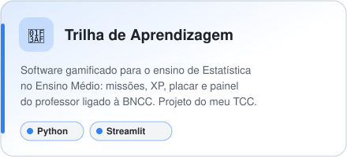
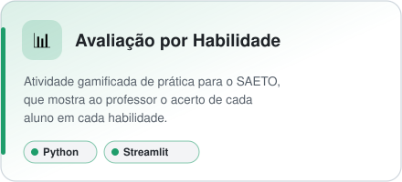
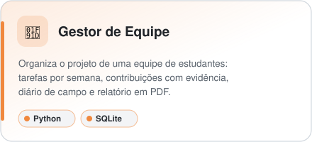
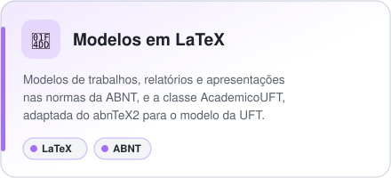

**Técnico em Informática · Licenciado em Matemática · Licenciando em Computação (UFT)**

Também crio ferramentas para a sala de aula: softwares educacionais gamificados em Python
e modelos LaTeX para trabalhos acadêmicos nas normas da ABNT.

---

## 🚀 Projetos em destaque

  <a href="https://github.com/wenesga/Trilha-de-Aprendizagem"><picture><source media="(prefers-color-scheme: dark)" srcset="assets/trilha-dark.svg" /></picture></a>
  <a href="https://github.com/wenesga/Avaliacao-Por-Habilidade"><picture><source media="(prefers-color-scheme: dark)" srcset="assets/avaliacao-dark.svg" /></picture></a>
  <a href="https://github.com/wenesga/Gestor-Equipe-Empreendedorismo"><picture><source media="(prefers-color-scheme: dark)" srcset="assets/gestor-dark.svg" /></picture></a>
  <a href="https://github.com/wenesga/Trabalhos-Academicos-LaTeX"><picture><source media="(prefers-color-scheme: dark)" srcset="assets/latex-dark.svg" /></picture></a>

  
  
  
  

## 🛠️ Ferramentas

  

## 🎓 Formação

- Licenciatura em Matemática — UFT
- Licenciatura em Computação — UFT *(em andamento)*
- Técnico em Tecnologia da Informação
- Especialização em Sistemas Fotovoltaicos

## 🔗 Links

---

  <picture>
    <source media="(prefers-color-scheme: dark)" srcset="https://raw.githubusercontent.com/wenesga/wenesga/output/github-contribution-grid-snake-dark.svg" />
    
  </picture>

